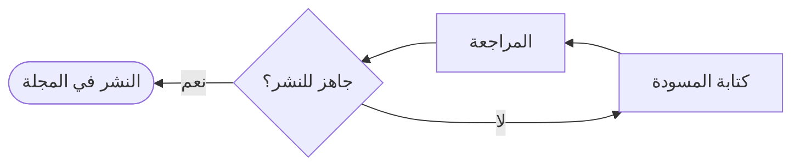

هذا **مقال تجريبي** كُتب لعرض شكل المقال في المجلة فقط، ولا يحتوي على معلومات تاريخية أو حقائق عن كتب أو أشخاص. استبدله بمقالك الحقيقي متى شئت.

## ما الذي تجده هنا؟

تنقسم المجلة إلى **أقسام** تظهر في أعلى الصفحة، وإلى **وسوم** تجمع المقالات المتقاربة في الموضوع. لكل مقال صفحة خاصة تعرض الغلاف والكاتب وتاريخ النشر ومدة القراءة التقريبية.

<callout type="tip" title="نصيحة">

استخدم البحث في أعلى الصفحة للعثور على مقال بكلمة من عنوانه أو ملخصه أو وسومه.

</callout>

## عناصر المقال

يمكن للكاتب أن يستخدم داخل المقال عناصر جاهزة تجعل القراءة أوضح:

- **التنبيه** لإبراز ملاحظة مهمة.
- **الاقتباس** لإبراز جملة من النص.
- **الخطوات** لشرح إجراء مرتّب.
- **المخطط** لرسم مسار أو علاقة بين أفكار.

<quote by="فريق التحرير" source="نص تجريبي">

هذا اقتباس تجريبي لعرض شكل الاقتباس داخل المقال.

</quote>

## مخطط تجريبي

يرسم المخطط التالي رحلة المقال من الكتابة إلى النشر:

### وماذا بعد؟

اقرأ المقالين التجريبيين الآخرين لتعرف كيف تكتب مقالاً جديداً وكيف يُنشر.
